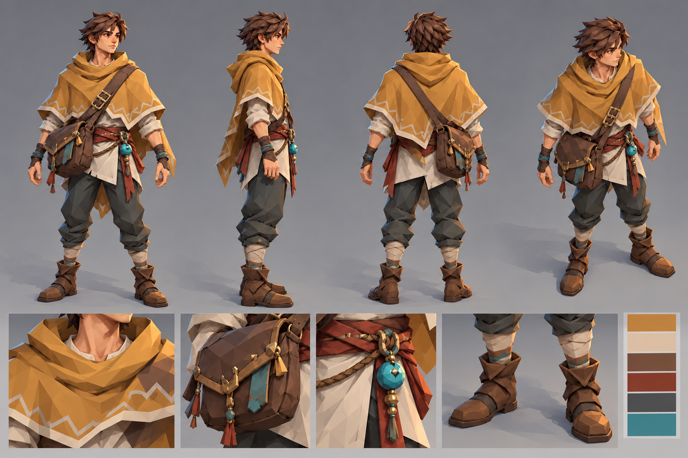

# Relic Seeker — character handoff

Use the turnaround sheet as the visual reference for the **player character**. He is an adult male-presenting explorer whose appearance can support different weapons and abilities. The concept is deliberately free of armor and class symbols. The sheet is a design guide, not a literal texture map; simplify small details when they disappear at the game camera distance.

## Shape hierarchy

1. **Ochre poncho:** The dominant shape. Make a broad, angular shoulder silhouette with a raised, loose cowl and an uneven pointed hem ending around the elbows. The front and back each have one large downward point. The pale zigzag trim is a thin edge accent, not a broad stripe. Keep the head distinct above the cowl from every facing.
2. **Head:** Uncovered face and short, tousled dark-brown hair. Avoid a helmet, hood, plume, or exaggerated hair spikes. The face should read as a warm skin tone at game scale; fine facial features are secondary.
3. **Cross-body satchel:** One large dark-leather bag at his **right hip** (viewer-left in the front view). Its strap crosses from his left shoulder over the front of the poncho. The bag is a strong asymmetrical silhouette cue and should remain visible in the game-camera view.
4. **Underlayers:** Off-white loose tunic beneath the poncho, a muted red-brown sash at the waist, dark charcoal trousers, pale calf wraps, and broad brown travel boots. The lower half should stay narrower than the poncho.
5. **Relic:** One small turquoise round charm hanging from the sash near his **left/front hip**, away from the bag. It is the brightest cool accent. It is jewelry or a found object, not a fixed magic-class emblem.

## Palette and materials

Use the sheet's swatches as the source. Approximate starting colors for a Three.js material pass: poncho ochre `#C88B39`, pale trim/tunic `#E5D5BE`, leather `#624335`, sash `#963F32`, trousers `#383D3F`, relic turquoise `#2F929B`, hair `#382820`. Treat these as starting values under the game's lighting, then judge the result in the figure bench. Cloth and leather should be rough and matte; use a restrained highlight only on the relic and small buckles.

## Motion and readability

- Preserve the current player's overall world height and ground contact; the existing figure test measures about 1.82 world units.
- The poncho hem should have a small, delayed response to running and dashing. It should settle at idle and never cover the head or weapon contact area.
- The bag may sway subtly as a secondary motion. Keep its anchor stable enough that it does not jump between facings.
- At gameplay size, the identifying shapes are the ochre shoulder triangle, dark diagonal strap and right-hip bag, and turquoise belt point. Omit tiny tassels and stitching if they add draw cost without improving those reads.
- The equipped weapon remains a separate gameplay attachment. The character's clothing should work with each weapon rather than implying one starting class.

## Implementation context

The current model is built in `game/app/dungeon-knight.ts` through `KNIGHT_SPEC`, `makeKnight()`, the cape, and the weapon pivot. The game reads named animation/attachment nodes from `userData`; preserve those contracts or update their consumers together. `game/tests/dungeon-figures.test.ts` checks figure height and render budgets. Use `npm run figures` from `game/` to inspect all facings, then a real gameplay screenshot to check the top-down silhouette. Add a regression for any changed gameplay behavior and follow the repository's planted-bug test rule.

This handoff defines the **look**. It does not request a weapon, combat-rule, HUD, or narrative change.
